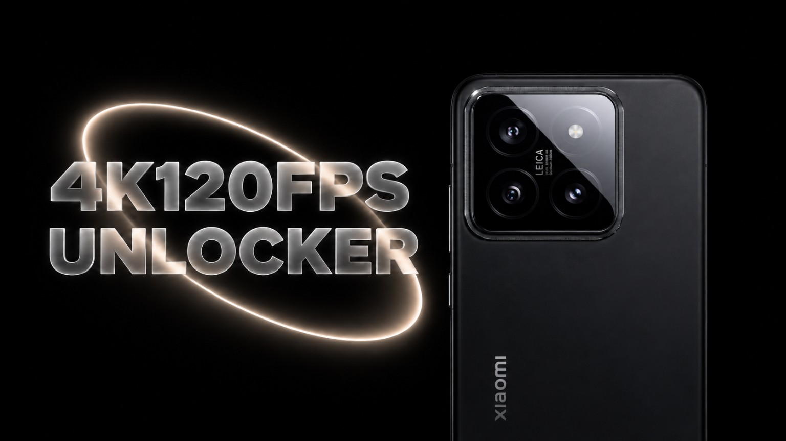

# Xiaomi14 4K120

KernelSU / Magisk module.

Experimental 4K120 video recording support for Xiaomi 14 (houji), with supported sunny OVX9000 wide and wide_ii sensor tables.

## Status

This build has not been tested on a phone. Actual 120fps recording, native HAL parsing, autofocus, stabilization and long recordings are not yet verified.

Each sensor table retains all 42 original modes and adds mode 42, based on the stock 4096×2304 RAW10 mode 17. The candidate changes frame timing and initial exposure registers, advertises NORMAL/HFR capabilities and adds `0@8@120` to `VideoSizeCustom`. This timing candidate does not establish that the sensor or HAL can sustain 4K120.

Offline checks verify CRC32, section and symbol bounds, unchanged original mode records and unchanged original symbol payloads except the resolution count and array.

Prepared from EliteRomLite OS3.0.303.0.WNCCNXM, Android 16. Installation checks the sensor hashes rather than the ROM name. Other sensor revisions are rejected.

## Install

Install the experimental ZIP through your root manager and reboot. Disable conflicting camera modules first.

Record a short 4K120 clip and verify its actual resolution, frame rate and duration. Check 4K30, 4K60, autofocus and stabilization. Use the module Action button to collect diagnostics if recording fails.

To restore stock, disable or remove the module and reboot.
